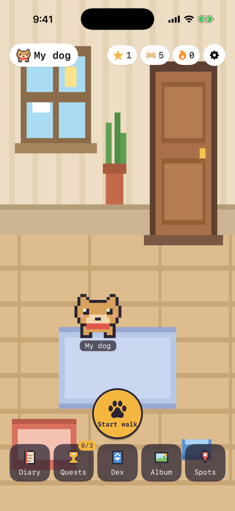
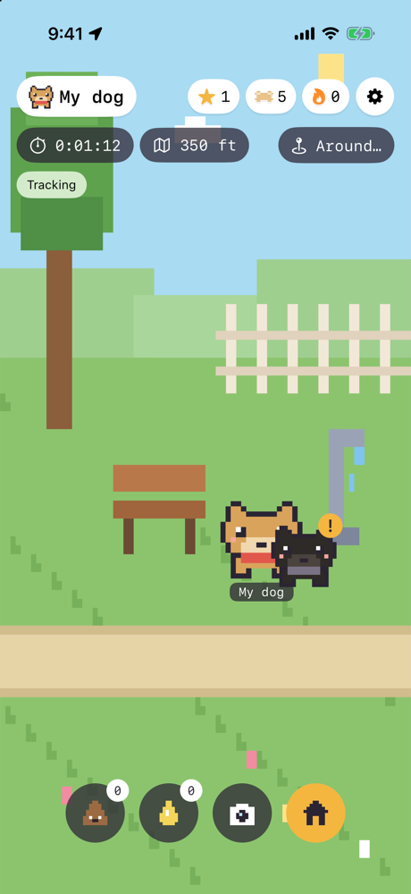
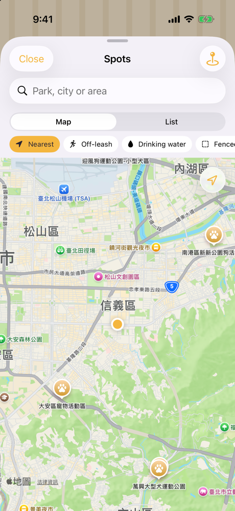
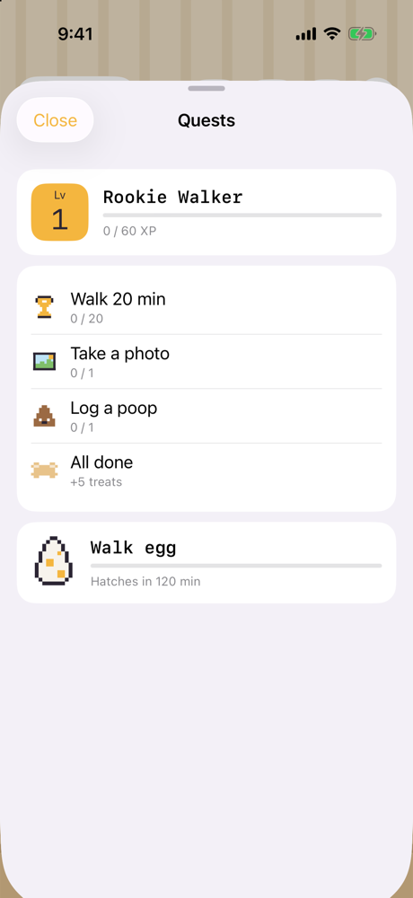
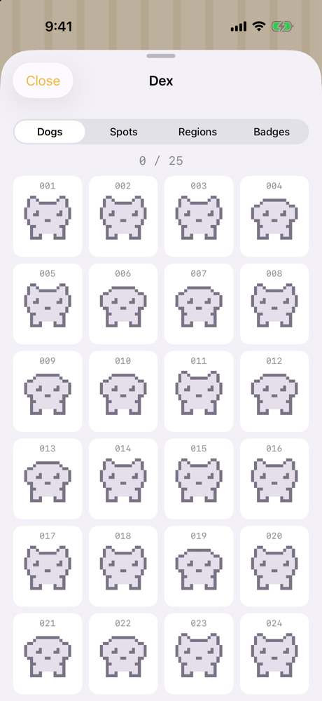

# Leash

A pixel-art dog-walking app for iPhone and iPad. Leash tracks your walks with GPS, logs potty breaks, and turns every outing into a small game: visiting dogs, quests, badges and a breed collection. It also helps you find dog parks near you.

Built natively in SwiftUI with no third-party dependencies. Available in English and 繁體中文.

## Screenshots

<p align="center">
  
  
  
  
  
</p>
<p align="center"><sub>Home · Walk · Spots · Quests · Dex</sub></p>

## Features

### Walk tracking
- Start and finish walks; elapsed time, route and distance are tracked live.
- Log pee and poop events during a walk.
- Background location keeps recording while the screen is locked.
- An unfinished walk is restored after the app is closed or relaunched.
- GPS filtering rejects inaccurate, stale or implausible fixes, and long gaps are split on the map rather than bridged.
- Walk diary with history and a summary for each walk.

### Game
- 25 dog breeds to collect in the Dex.
- Visiting dogs appear during walks (one minute in, then every eight minutes); toss treats to befriend them.
- Every 120 outdoor minutes hatches an egg dog of uncommon rarity or better.
- XP, levels, treats, streaks, quests, badges and tips — all calculated from your walk history, so progress can't drift out of sync.
- A customizable dog profile.

### Park discovery
- About 8,500 dog parks across Taiwan and the US, bundled from OpenStreetMap (works offline).
- Map and list views, sorted nearest first, with combinable filter chips.
- Park details: address, opening hours, facilities and leash policy. Facilities missing from the data show as "Not verified".
- **Go** opens walking directions in Apple Maps and links your next walk to that park.
- Add your own custom spots.

### Album
- Take or pick photos of your dog and keep them in an in-app album.

### Look and feel
- Hand-drawn pixel-art room and park scenes rendered with SwiftUI Canvas, with day and night artwork.
- A wandering pixel dog that respects Reduce Motion.
- Language switcher in Settings (gear icon, top right). The default follows your device language.

## Requirements

- Xcode 26 or later
- iOS 17.6 or later (iPhone or iPad)
- Swift 6

## Getting started

```bash
git clone https://github.com/YENCHUNYU/Leash.git
cd Leash
open Leash.xcodeproj
```

Select the **Leash** scheme and run on a simulator or device. To test background route tracking, use a physical iPhone. In the simulator, use **Features → Location** to simulate a walking route.

## Running tests

Unit tests use Swift Testing and cover GPS filtering, the walk view model, file storage and migration, game rules and park search.

```bash
xcodebuild test -scheme Leash -destination 'platform=iOS Simulator,name=iPhone 17'
```

Or press **⌘U** in Xcode.

## Project structure

```
Leash/
  App/            Entry point and root view
  Shared/         Design system (theme, pixel art), localization, JSON persistence
  Resources/      Bundled dog-park data, launch screen strings
  Features/
    WalkTracking/ GPS, walk models, view model, home/diary/summary views
    Game/         Breeds, progress, encounters, Dex, quests, profile
    Spots/        Park catalog, search and filters, map and detail views
    Album/        Photo library and camera
    Launch/, Settings/
LeashTests/       Unit tests
```

The app uses feature-first MVVM with injected services, so tests can swap in fake storage and location. See [ARCHITECTURE.md](ARCHITECTURE.md) for details.

## Privacy

All data — walks, photos, game progress — is stored locally on the device in Application Support. There are no accounts and no cloud sync. Location is used only to record walks and to sort nearby parks.

## Data attribution

Dog-park data © [OpenStreetMap](https://www.openstreetmap.org/copyright) contributors, available under the Open Database License (ODbL). The data is a bundled snapshot, not live.
